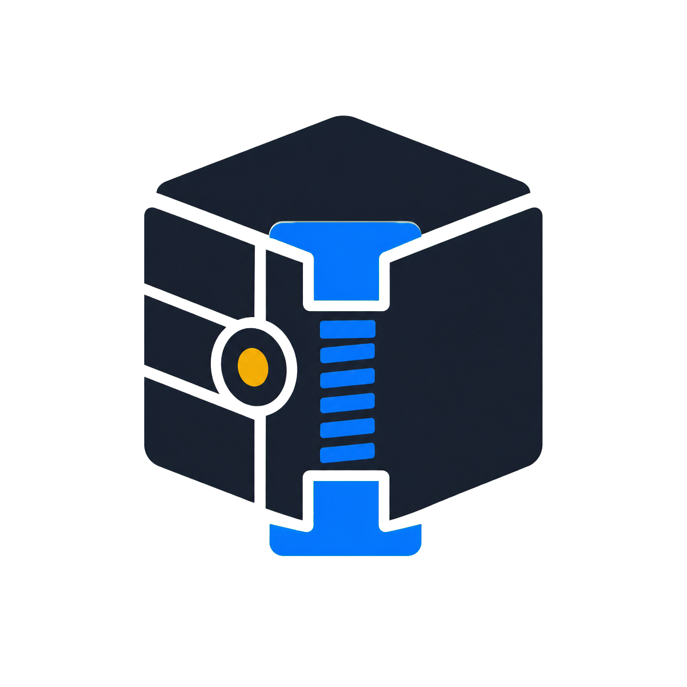

# Rat-Trap 5.7

**Compress it. Find it. Get it back.**

A local Windows workspace for compact archives, searchable Vaults, versioned
backups and protected files. Keep your files useful after you put them away.

## Download for Windows

**[Download Rat-Trap for Windows](https://github.com/Martin123132/Rat-Trap-Next-Gen-Compression-Engine/releases/download/v5.7.0-preview.12/Rat-Trap-Windows-x64-setup.exe)**

Windows 10 or later, 64-bit. No Python, Codex or Rat-Trap account required.

This is an **unsigned public preview**. Read the [installation guide](docs/WINDOWS.md)
and [release notes and checksum](docs/releases/5.7.0-preview.12.md). If Windows
blocks it, do not disable security protection. Keep originals and independent
backups while using a preview.

## Why Rat-Trap?

- **Put less repeated data on disk.** Balanced archives reuse eligible exact
  duplicate files. Versioned backup repositories reuse matching chunks
  across snapshots.
- **Find what you filed away.** Queryable Vaults search filenames and supported
  text without extracting the entire collection.
- **Keep earlier versions within reach.** Browse backup history and restore an
  older snapshot into a separate folder, leaving your current files alone.
- **Keep projects organised.** The Library brings stored work, a project
  timeline, cross-Library filename search and direct single-file restore
  together in one place.
- **Save your backup setup.** Remember a source, destination and project in a
  backup plan, then create another version when you choose **Back up now**.
- **Check what you keep.** Run a manual Library health check on supported
  Vaults and versioned backups and see dated results alongside your work.
- **Protect files with a recovery route.** Optional authenticated archive
  encryption and independent Sealed Files support passwords and separately
  stored recovery keys.
- **Work with data, not just containers.** Turn supported CSV, TSV, JSON and
  related sources into local tables; filter rows visually or use read-only SQL.
- **Learn by doing.** Five built-in walkthroughs use fictional files, explain
  each action, and guide you through the real workflow.
- **Stay local.** No required account, automatic cloud upload or telemetry
  service. The standalone app works without an AI assistant.

## Choose how you store

| I want to… | Use… |
|---|---|
| Make a compact archive or share a folder | **GMW archive** — Fast, Balanced or Smallest |
| Search stored filenames, text and data tables | **Queryable Vault** |
| Keep versions and recover an earlier state | **Backups & history** |
| Organise stored projects and run saved backup plans | **Library & timeline** |
| Protect an individual file | **Sealed File** with a separate recovery key |

Live backup repositories are not encrypted in this release. Choose the
supported encrypted portable formats when you need that protection.
Compression by itself is not encryption.
Saved backup plans run manually; no background scheduling is included. A
Library entry or health check is not an independent backup.

## Your first few clicks

1. Install Rat-Trap and open **Rat-Trap Desktop Preview 2** from Start.
2. Choose **Show me how…**.
3. Pick what you want to learn:
   **Find a file inside a Vault**, **Compress a folder**, **Restore your files**,
   **Protect a file and recover it**, or **Browse backup history**.

The tutorials use made-up files. Back and Exit remain available.
Then try copies of your own files and restore them into a new folder to check
the result.

The installed name is retained so existing Preview 2 users receive an
in-place update, not another application. GitHub's automatically generated
source-code ZIPs are for developers; the download above is the Windows installer.

## Explore the technology

The [technical documentation](docs/TECHNICAL.md) is the starting point for
engineers, reviewers and commercial buyers: complete benchmark matrices,
preserved results, formats, compatibility, security boundaries and test evidence.

- [Benchmark audit and complete comparisons](BENCHMARK-AUDIT.md)
- [Benchmark history and evidence status](docs/BENCHMARK-HISTORY.md)
- [Public benchmark result files](benchmarks/results/2026-07-18/README.md)
- [Earlier preview qualification](docs/releases/5.7.0-preview.6.md)
- [Latest preview qualification](docs/releases/5.7.0-preview.12.md)
- [Run from source and contribute](CONTRIBUTING.md)

## Support and commercial use

Rat-Trap is published by **TWO HANDS NETWORK LTD**.

Personal and non-commercial use is covered by the
[PolyForm Noncommercial License 1.0.0](LICENSE.md). This is **source-available**
software. Commercial use requires a separate written
[commercial licence](COMMERCIAL-LICENSE.md).

For support or commercial enquiries: **ollett123123@outlook.com**.
See [support guidance](SUPPORT.md), [privacy](PRIVACY.md) and
[security reporting](SECURITY.md). Never send passwords, recovery keys or
confidential files in a public issue.

The compressor implementation was designed and built by **Glyn Evans and Martin Ollett**, drawing
on Motion-TimeSpace work by **Martin Ollett**.
[Historical project narrative and provenance](docs/HISTORICAL-PROJECT-NARRATIVE.md)
and the [original experiments](historical/README.md) remain available.
